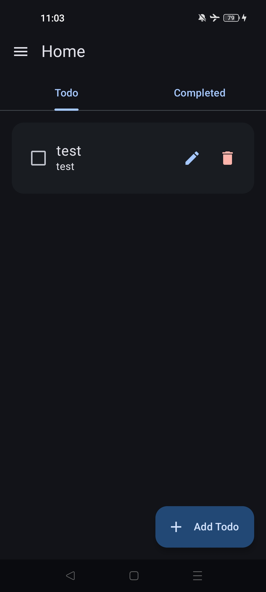
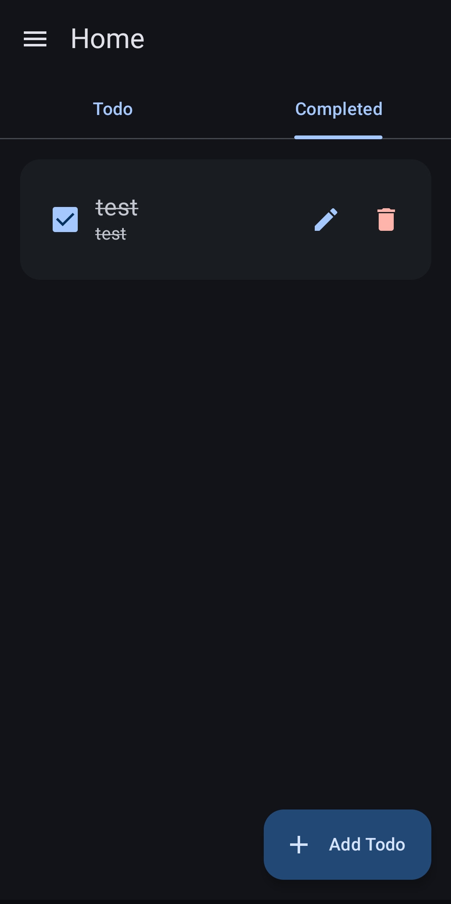
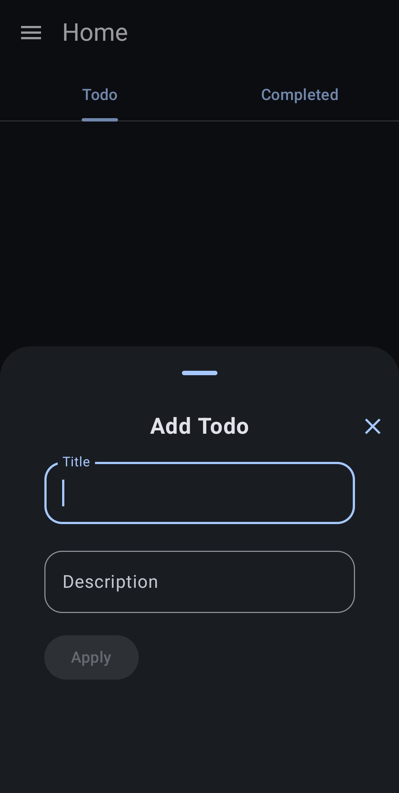

# LessTodo

LessTodo is a clean, minimal todo app for Android, built with Kotlin, Jetpack Compose, and Material 3.
Designed to keep task management simple and distraction-free, with a focus on usability, smooth animations, and a native Android experience.


[](https://github.com/E3TU/LessTodo/releases/latest)

## Download

[](https://github.com/E3TU/LessTodo/releases/latest)

The APK is signed for sideloading, not for Play Store distribution. Enable "Install unknown apps" for your browser or file manager, then open the downloaded file.

## Features

- **Separate tabs** for active and completed todos, with a slide-and-fade transition between them
- **Add and edit** todos in a modal bottom sheet — title plus an optional description
- **One-tap complete** — toggling a checkbox moves the todo to the Completed tab, with animated row transitions
- **Material You** dynamic color on Android 12+, toggleable from Settings
- **Dark mode** that follows your system theme, with a matching launch screen so there's no white flash
- **Edge-to-edge** layout that respects system bars and the keyboard
- **Offline-first** — everything lives in a local Room database, no network permission required

## Tech Stack

- Kotlin
- Jetpack Compose
- Material 3
- Gradle

## Screenshots

<p align="center">



</p>

<p align="center">
<em>Active todos · Completed todos · Add</em>
</p>

## Build from source

### Prerequisites

- Android Studio (latest stable)
- JDK 17+
- Android SDK with API 37 platform installed

### Build

```bash
git clone https://github.com/E3TU/LessTodo.git
cd LessTodo
./gradlew assembleDebug
```

The APK lands in `app/build/outputs/apk/debug/`.

You'll need a `local.properties` file at the repo root with your SDK path:

```properties
sdk.dir=/path/to/Android/Sdk
```

Android Studio creates this automatically on first open. It is git-ignored and must not be committed.

### Install

Prefer a prebuilt binary? Grab the APK from [Releases](https://github.com/E3TU/LessTodo/releases/latest). Or install what you just built:

```bash
./gradlew installDebug
```

> Self-built APKs use a different signing key than the published one. Uninstall the released build first before installing your own.

## Project status

Early development, actively worked on. Data is stored locally only — there is no sync, export, or backup yet.

## License

MIT — see [LICENSE](LICENSE).
